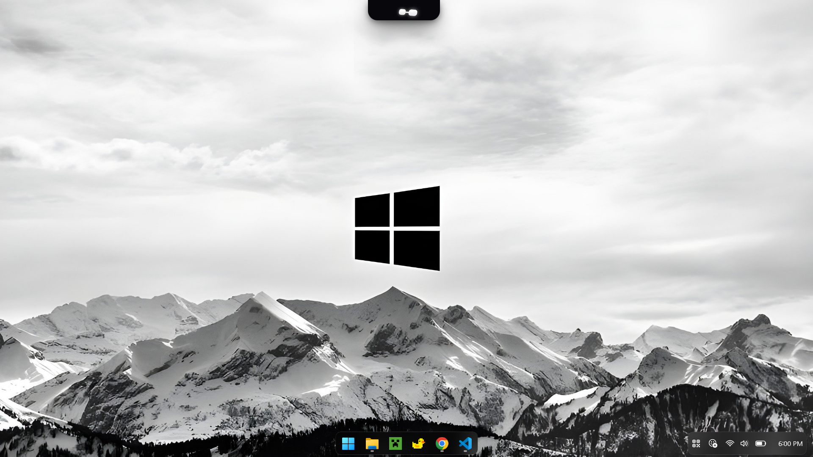
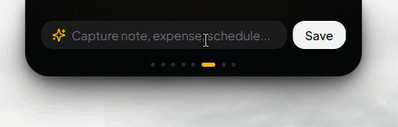
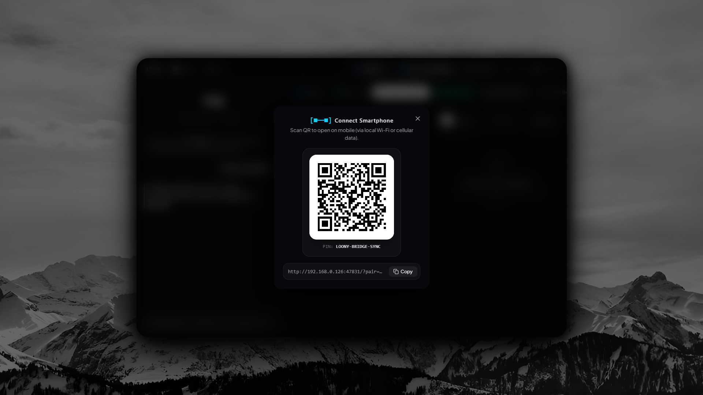
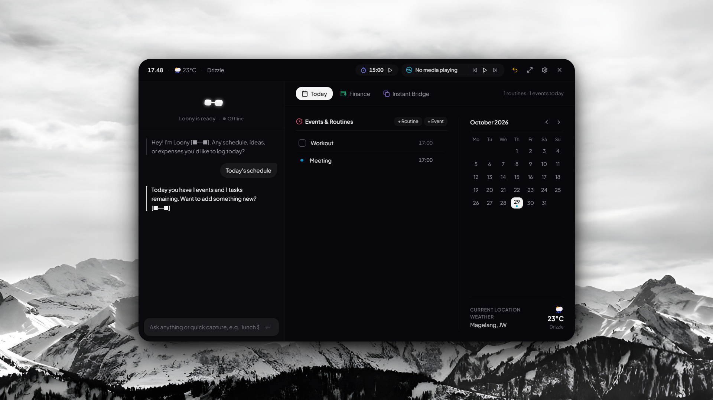

# Loony Gen 2

<p align="center">
  <br />
  <code>[ ■ ━ ■ ]</code>
  <br />
  <strong>A tactile desktop companion and minimalist productivity island for Windows.</strong>
  <br />
  <em>Stay focused and organized without the clutter of heavy productivity suites.</em>
</p>

<p align="center">
  <strong>English</strong> • <a href="README.id.md">Bahasa Indonesia</a>
</p>

<p align="center">
  <a href="https://github.com/Jipung7/Loony/releases/latest"></a>
  <a href="#"></a>
  <a href="LICENSE"></a>
  <a href="#"></a>
  <a href="https://github.com/Jipung7/Loony/discussions"></a>
</p>

<p align="center">
  
</p>

<p align="center">
  <a href="https://github.com/Jipung7/Loony/releases/download/v1.0.2/Loony-Setup-v1.0.2.exe"><strong>Download Installer (.exe)</strong></a> • 
  <a href="https://github.com/Jipung7/Loony/releases/download/v1.0.2/Loony-Portable-v1.0.2.exe"><strong>Download Portable (.exe)</strong></a> • 
  <a href="CHANGELOG.md">Changelog</a> • 
  <a href="https://github.com/Jipung7/Loony/releases/latest">Release Notes</a>
</p>

---

## The Idea Behind Loony

Most productivity tools demand too much attention: endless configurations, subscription models, and complex boards that turn simple notes into work.

Loony takes a different approach. It rests quietly at the edge of your screen as a dark obsidian capsule (`#0b0b0f`). It stays out of your way, lets you click through transparent areas to your apps beneath, and gives you quick access to essential daily tools—a timer, scratchpad, media controls, and a direct local phone-to-PC bridge.

No cloud accounts. No telemetry. Just a reliable companion on your desktop.

---

## Core Capabilities

### 1. Compact Obsidian Capsule & Holo-Visor
- **Tactile Spring Physics:** Tap, drag, or release the capsule to feel the bouncy spring physics powered by Framer Motion.
- **Edge Snapping:** Release near any screen edge, and it smoothly snaps into place with magnetic dampening.
- **Win32 Click-Through Overlay:** Transparent areas surrounding the capsule let mouse clicks pass directly through to your editor, browser, or game underneath.
- **Expressive Robot Eyes (`[■━■]`):** The Holo-Visor blinks, sleeps when you are away, purrs when hovered, and bobs gently along with music playing on your system.

<p align="center">
  
</p>

<p align="center">
  
</p>

---

### 2. Quick Capsule Productivity Tools
Hover over the capsule dots to switch between lightweight mini-tools without opening full windows:
- **Focus Timer:** Quick Pomodoro and custom countdown sessions to keep you on track.
- **Scratchpad & Checklist:** Jot down temporary thoughts or check off quick sub-tasks.
- **Media Controls (GSMTC):** Direct playback status and track controls for Spotify, YouTube, and Windows media players.
- **Clock & Prayer Times:** Built-in prayer timetable calculation (Kemenag RI method) with a quick meeting mute switch.

---

### 3. Local LAN Phone ⇄ PC Bridge
Connect your smartphone (Android or iOS) to your Windows desktop in seconds over your local Wi-Fi or hotspot:
- **QR Code Pairing:** No registrations, passwords, or cloud servers required. Scan the on-screen QR code from your phone's browser.
- **Shared Clipboard:** Copy links or snippets on your phone, and have them instantly ready on your Windows clipboard.
- **Direct File Transfer:** Drop photos or documents from your phone straight into your PC's `Downloads/LoonyBridge` folder over LAN speed.
- **Private by Design:** Traffic stays strictly inside your local network.

<p align="center">
  
</p>

---

### 4. Full Dashboard & Daily Planning
Click the mascot mask to expand into a calm, dark obsidian dashboard for a broader overview:
- **Safe-to-Spend Budget:** A simple daily allowance calculator that adjusts automatically based on your daily spending so you never run short before payday.
- **IOU & Debt Ledger:** Keep track of borrowed or lent money that stays visible until marked settled.
- **Habit Streaks:** Daily micro-habits that reset at 04:00 AM, keeping your streaks intact during late-night work sessions.

<p align="center">
  
</p>

---

## Download & Installation

Loony is free and open-source. Choose the package that suits your setup:

| Package | Recommended Use | Architecture | Download Link |
| :--- | :--- | :---: | :--- |
| **Loony Setup (v1.0.2)** | Regular desktop installation (auto shortcut & updater) | Windows x64 | [Download Setup (.exe)](https://github.com/Jipung7/Loony/releases/download/v1.0.2/Loony-Setup-v1.0.2.exe) |
| **Loony Portable (v1.0.2)** | Standalone binary (great for USB drives, zero install) | Windows x64 | [Download Portable (.exe)](https://github.com/Jipung7/Loony/releases/download/v1.0.2/Loony-Portable-v1.0.2.exe) |

### System Requirements
- **OS:** Windows 10 (64-bit) or Windows 11.
- **Memory:** Lightweight footprint (~120 MB – 180 MB RAM).
- **Dependencies:** None. Self-contained runtime; no Node.js or Python required.

---

## Building from Source

Loony is built with modern web tools running in an optimized Electron desktop shell:
- **UI Framework:** React 19, TypeScript, Tailwind CSS v4, Framer Motion.
- **Desktop Shell:** Electron 34 with native Win32 window management and PowerShell interop.
- **Local Bridge:** Embedded HTTP server running on local LAN port.

### Development Steps
```bash
# 1. Clone the repository
git clone https://github.com/Jipung7/Loony.git
cd Loony

# 2. Install dependencies
npm install

# 3. Start development server
npm run dev

# 4. Run Electron app
npm run electron

# 5. Build production Windows binaries
npm run dist:win
```

---

## Support & Community

Loony is an independent passion project created by a solo developer. If Loony makes your workday calmer or more organized, here are ways to support the project:

- **Star the Repository:** Helps other developers discover Loony on GitHub.
- **Join Discussions:** Share feature suggestions, bug reports, and feedback on [GitHub Discussions](https://github.com/Jipung7/Loony/discussions).
- **Tip a Matcha (Global):** Support ongoing maintenance on [Ko-fi](https://ko-fi.com/jipung) *(PayPal / Credit Cards)*.
- **Dukungan Lokal (Indonesia):** Traktir lewat [Saweria](https://saweria.co/jipung) atau [SociaBuzz](https://sociabuzz.com/jipung) *(QRIS, GoPay, OVO, DANA)*.

---

## License

Distributed under the **MIT License**. Free for personal and commercial use.  
Crafted by **Jipung** ([@Jipung7](https://github.com/Jipung7)) — *Lone Steed Studio*.
