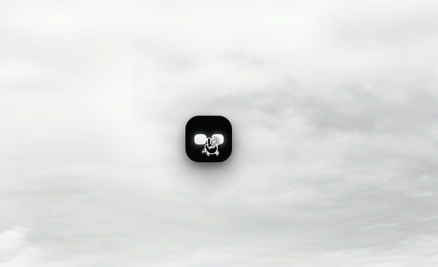

# 🤖 Loony Gen 2

<p align="center">
  <br />
  <code>[ ■ ━ ■ ]</code>
  <br />
  <strong>A tactile, quirky desktop companion & minimalist productivity island for Windows.</strong>
  <br />
  <em>"Stay productive, without feeling overwhelmed."</em>
</p>

<p align="center">
  <strong>English</strong> • <a href="README.id.md">Bahasa Indonesia</a>
</p>

<p align="center">
  <a href="#-download--get-started"></a>
  <a href="#"></a>
  <a href="LICENSE"></a>
  <a href="#"></a>
  <a href="#"></a>
  <a href="#"></a>
  <a href="https://github.com/Jipung7/Loony/discussions"></a>
</p>

<!-- HERO VISUAL: THE COMPANION IN ACTION -->
<p align="center">
  
</p>

<!-- ABOVE-THE-FOLD DOWNLOAD CTA -->
<p align="center">
  <a href="https://github.com/Jipung7/Loony/releases/latest">
    
  </a>
</p>
<p align="center">
  <sub>⚡ <strong>Zero Setup:</strong> No Node.js or terminal required. Just double-click and Loony comes to life.</sub>
</p>

---

## ✨ What Makes Loony Feel Different

Most productivity suites feel like homework: 40 spreadsheet categories, monthly subscriptions, and endless notifications that guilt-trip you into working. 

Loony takes the opposite path:

### 🧲 1. A Living, Magnetic Island
Loony lives at the top bezel of your screen as an ultra-compact obsidian pill. Drag it anywhere across your monitors—let go near an edge, and it smoothly snaps like a soft magnet with natural squash-and-rebound physics.

<p align="center">
  
</p>

- **Win32 Click-Through Overlay:** Transparent zones around the capsule are 100% click-through. You can click browsers and code editors underneath without friction.
- **Responsive Personality:** Pet Loony's head with your cursor and watch it purr `(^━^)`.
- **Sensory Awareness:** It dances subtly when Spotify or YouTube plays music, gets dizzy if you shake it, and dozes off when you step away from your desk.

---

### 🌉 2. Zero-Friction Phone ⇄ PC Bridge
Connect your phone (Android or iPhone) to your Windows desktop in 3 seconds:

<p align="center">
  
</p>

- **Just Scan & Go:** No account registration, no passwords, no email verification. Scan the on-screen QR code and you're paired.
- **Shared Clipboard:** Copy a tracking code, address, or snippet on your phone—it's immediately on your PC clipboard.
- **Drop & Land:** Shoot a photo on your phone, tap send, and it lands right in your laptop’s `Downloads/LoonyBridge` folder over local Wi-Fi.
- **True Privacy (E2EE):** Everything is encrypted locally with AES-256 before transit. Your notes and files never touch a public cloud server.

---

### 💰 3. "Safe-to-Spend" & Natural Language Planning
No need to fiddle through complex calendars or heavy finance sheets. Open Loony and quickly jot down what matters today:

<p align="center">
  
</p>

- `"Gas 35k"` or `"Coffee $4"` ➔ Automatically deducted from your daily allowance.
- **"Safe-to-Spend" Algorithm:** Calculates **one dynamic daily number**. Spent more today? Tomorrow recalibrates automatically so you never run out of money before payday.
- `"Team retro tomorrow 2pm"` ➔ Added to your schedule with automatic conflict detection.
- `"Idea: retro terminal theme"` ➔ Tucked away safely in your Idea Vault.

---

### 🖥️ 4. Full Desktop Command Center
When you want to see the big picture, click Loony's mask to unfold into a tranquil, Dark Matte Obsidian dashboard:

<p align="center">
  
</p>

- **Persistent IOU / Debt Ledger:** Track borrowed money and obligations that never vanish until marked "Settled".
- **Daily Habit Streaks:** Micro-reminders that reset at 04:00 AM so late-night shifts don't break your momentum.
- **Automatic Prayer Times:** Auto-calculated prayer timetable via Kemenag RI (Method 20) with quick 1-click meeting mute.

---

## 💡 Why Loony Exists (The Creator's Note)

> *"I originally built Loony because I was tired of emailing links to myself, juggling heavy companion apps that eat my RAM, and staring at a cold, soulless desktop screen.*
>
> *I wanted something tactile and lightweight. A companion that lives at the top of my display like an elastic magnet—innocent and playful, but firm enough to keep me on track. Something that lets me drop files from my phone to my PC without passwords or cloud accounts.*
>
> *That’s how Loony was born. It started as a personal bridge, but it grew a soul of its own."*  
> — **Jipung**, Creator of Loony  
> *(Crafted with heart and the help of AI)*

---

## 📥 Download & Get Started

Loony is 100% free and open-source. Choose the package that fits your workflow:

| Package | Best For | Architecture | Direct Download |
| :--- | :--- | :---: | :--- |
| **🚀 Loony Setup (v1.0.1)** | **Recommended for Daily Use** | Windows x64 | **[Download Setup (.exe)](https://github.com/Jipung7/Loony/releases/download/v1.0.1/Loony-Setup-v1.0.1.exe)** |
| **📦 Loony Portable (v1.0.1)** | **Travelers & USB Flash Drives** | Windows x64 | **[Download Portable (.exe)](https://github.com/Jipung7/Loony/releases/download/v1.0.1/Loony-Portable-v1.0.1.exe)** |

### System Requirements
- **Operating System:** Windows 10 (64-bit) or Windows 11.
- **Memory Consumption:** Extremely lightweight (~120 MB – 180 MB RAM). Runs smoothly even on laptops with 4 GB RAM.
- **Prerequisites:** **None.** You do *not* need Node.js, Python, or Git installed.

---

## 🛠️ For Developers & Tinkerers

Loony is crafted with modern web technologies packaged into an ultra-optimized native shell:
- **Frontend Core:** React 19, TypeScript, Tailwind CSS v4, Framer Motion.
- **Desktop Shell:** Electron with native Win32 sensor bridges.
- **Bridge Protocol:** W3C Web Crypto (AES-GCM-256), WebRTC P2P DataChannels, Local HTTP Server.

### Running from Source
```bash
# 1. Clone the repository
git clone https://github.com/Jipung7/Loony.git
cd Loony

# 2. Install dependencies
npm install

# 3. Start development mode
npm run dev

# 4. Build Windows binaries
npm run dist:win
```

---

## 🍵 Support the Project (Jajanin Loony)

Loony is an independent passion project built by a solo creator. If Loony brings a smile to your face, keeps your desktop serene, or makes your workday a little lighter, consider supporting its journey! *(Fun fact: Jipung doesn't drink coffee, but loves Matcha 🍵)*

### 🌏 International / Global Supporters:
- 🍵 **[Buy Jipung a Matcha on Ko-fi](https://ko-fi.com/jipung)** *(Supports PayPal, Credit / Debit Cards)*
- ⭐ **Star this repository** on GitHub (it helps more people discover Loony!)
- 💬 Share your feedback and ideas in [GitHub Discussions](https://github.com/Jipung7/Loony/discussions)

### 🇮🇩 Teman-Teman Indonesia (Dukungan Lokal):
- 🎁 **[Saweria (saweria.co/jipung)](https://saweria.co/jipung)** *(Bisa scan QRIS, GoPay, OVO, DANA, ShopeePay)*
- ⚡ **[SociaBuzz (sociabuzz.com/jipung)](https://sociabuzz.com/jipung)**

---

## 📄 License

Distributed under the **MIT License**. Free for personal and commercial use.  
Crafted with heart by **Jipung** ([@Jipung7](https://github.com/Jipung7)) with the help of AI — *Lone Steed Studio*.
